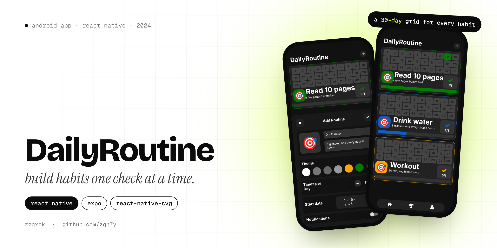
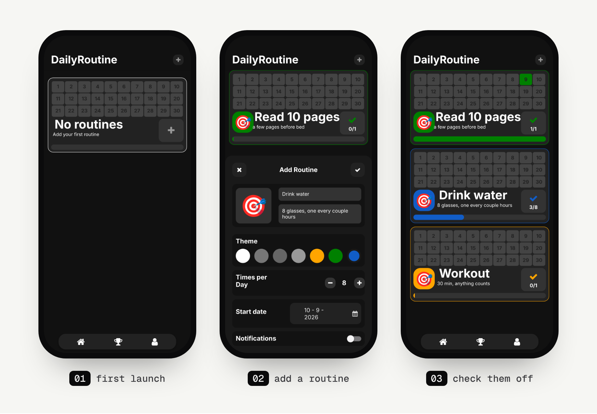

<p align="center">
  
</p>

<p align="center">
  
  
  
</p>

# DailyRoutine

DailyRoutine is a habit tracker. You add the things you want to do every day, like reading, drinking water or working out, and check them off as you go. Every routine gets its own card with a 30-day grid, so you can see at a glance which days you actually did it.

It's a 2024 project with a dark UI, coloured cards and a floating tab bar.

## Screens

<p align="center">
  
</p>

<sub>The routines in the screenshots are sample data.</sub>

## Features

- **Add a routine** with a name (15 characters), a short description (80 characters) and an emoji from a searchable emoji picker.
- **Pick a theme colour** for each routine. The card's border, icon and progress bar all use it.
- **Times per day.** "Drink water" can be 8 times a day, "Read" once. Each tap on the check adds one, the bar fills up, and today's square on the 30-day grid lights up when you're done.
- **Start date** for each routine, picked with a date picker.
- **Daily reminder.** Turn on notifications and the app reminds you every day at the time you picked.
- **Goals screen** with animated progress rings drawn with `react-native-svg`.

## Status

This one is unfinished. Routines are kept in memory, so they reset when the app is closed (saving them with AsyncStorage is the next step). The Goals screen is built but doesn't receive the routines yet, and the profile tab is a placeholder.

## How it's built

| Part | Tech |
|---|---|
| Framework | React Native 0.74, Expo SDK 51 |
| Navigation | React Navigation (native stack) |
| Graphics | `react-native-svg` for the progress rings |
| Animation | React Native `Animated` for the cards and bars, `react-native-reanimated` for the rings |
| Inputs | `@react-native-community/datetimepicker`, `react-native-emoji-selector` |
| Reminders | `expo-notifications` |

## Run it yourself

```bash
git clone https://github.com/zqh7y/DailyRoutine.git
cd DailyRoutine
npm install
npx expo start
```

Scan the QR code with Expo Go, or press `a` for an Android emulator.

---

<p align="center">
  Made by <b>zzqxck</b> · <a href="https://zqh7y.github.io/Portfolio/">portfolio</a> · <a href="https://github.com/zqh7y">more projects</a>
</p>
